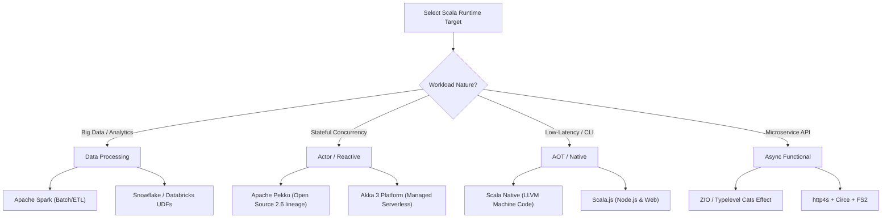

# 🚀 Awesome-Scala-Extensibility-Runtime

  
  
  
  
  
  

  

---

## 📖 Introduction & SEO Overview

**Awesome Scala Extensibility & Runtime** is an authoritative, community-curated directory tracking enterprise **SaaS platforms**, **cloud distributed compute engines**, and **open-source frameworks** tailored for Scala execution. 

Whether deploying **Scala UDFs** in cloud warehouses (Snowflake, Databricks), orchestrating petabyte-scale data pipelines on **Apache Spark**, scaling concurrent microservices with the **actor model** (Akka, Apache Pekko), or compiling ahead-of-time microservices via **Scala Native**, this repository provides up-to-date pricing, free-tier limits, market dynamics, and architectural guidance for technical leads, data engineers, and Scala developers.

### 🔍 Key Focus Areas & Keywords
- **Scala UDF Runtimes & Lakehouses**: Snowflake Scala UDFs, Databricks Connect, AWS EMR, Google Cloud Dataproc.
- **Distributed Big Data Compute**: Apache Spark, Apache Flink, Livy, Apache Toree.
- **Actor Model & Reactive Microservices**: Akka 3 Serverless, Apache Pekko, Finagle.
- **Ahead-Of-Time (AOT) & Functional Runtimes**: Scala Native, Scala.js, ZIO, Typelevel Cats, FS2.

---

## 📑 Table of Contents

- [📊 Sector Overview & Market Dynamics](#-sector-overview--market-dynamics)
- [☁️ SaaS & Hosted Scala Platforms](#️-saas--hosted-scala-platforms)
- [🐙 Open-Source GitHub Projects](#-open-source-github-projects)
- [⚖️ Architectural Comparison & Stack Recommendations](#️-architectural-comparison--stack-recommendations)
- [🤝 How to Contribute](#-how-to-contribute)
- [⚠️ Disclaimer](#️-disclaimer)
- [📈 Star History](#-star-history)
- [💖 Support & Community](#-support--community)

---

## 📊 Sector Overview & Market Dynamics

The global distributed data compute, serverless processing, and cloud language runtime sector is valued at an estimated **$18.5 Billion in 2026** and is forecasted to exceed **$38.2 Billion by 2030** (CAGR ~16.8%).

Market dynamics reveal **high concentration** at the enterprise lakehouse and cloud infrastructure layer—dominated by hyperscalers (Microsoft Azure, Google Cloud, AWS) alongside specialist data platforms (Snowflake, Databricks) that capture the vast majority of commercial Scala data workloads. Conversely, the runtime and framework tier remains **moderately fragmented** between production actor-system runtimes (commercial Akka vs. open-source Apache Pekko), pure functional effect systems (Typelevel Cats, ZIO), and emerging ahead-of-time compilation runtimes (Scala Native).

---

## ☁️ SaaS & Hosted Scala Platforms

The following enterprise platforms provide managed runtimes for executing Scala workloads, User-Defined Functions (UDFs), and distributed Spark jobs without managing underlying cluster infrastructure. 

*Entries are sorted descending by company scale (Valuation / Market Capitalization).*

| 🏢 Platform / Service | 💼 Provider & Scale (Valuation / Revenue) | 📝 Description & Extensibility Features | 💰 Specific Pricing Model | 🎁 Specific Free Tier / Trial Limit |
| :--- | :--- | :--- | :--- | :--- |
| **[Azure HDInsight Scala](https://azure.microsoft.com/en-us/products/hdinsight)** | **Microsoft** 📊 ~$3.1 Trillion Market Cap 💵 ~$245B+ Annual Revenue | Enterprise managed analytics service hosting Apache Spark, Kafka, and Hadoop on Azure. Executes Scala Spark jobs, Livy REST jobs, and custom JAR pipelines with Active Directory security. | Starts at **$0.081/hour** for HDInsight cluster management nodes + underlying VM compute (e.g., D3 v2 from **$0.14/vCPU-hr**). | **Azure Free Account**: **$200 credit** for 30 days + 12 months of select free services + 55+ always-free services. |
| **[Google Cloud Dataproc Scala](https://cloud.google.com/dataproc)** | **Alphabet / Google** 📊 ~$2.1 Trillion Market Cap 💵 ~$307B+ Annual Revenue | Managed Apache Spark and Hadoop service supporting native Scala JARs, Dataproc Serverless, and per-second billing with auto-scaling cluster topology. | Compute management surcharge of **$0.010 per vCPU-hour** + standard Compute Engine VM instances (e.g., e2-standard-4 at **$0.134/hr**). | **Google Cloud Free Trial**: **$300 free credits** valid for 90 days across all GCP services with no initial billing commitment. |
| **[AWS EMR Scala](https://aws.amazon.com/emr/)** | **Amazon / AWS** 📊 ~$1.9 Trillion Market Cap 💵 ~$575B+ Annual Revenue | Managed big data platform for running distributed Scala jobs across EMR on EC2, EMR on EKS, or EMR Serverless without node provisioning. | Management fee from **$0.0105/instance-hr** (e.g., m5.xlarge adds **$0.048/hr** to EC2 cost) or EMR Serverless at **$0.052624/vCPU-hr**. | **AWS Free Tier**: 12 months access with up to **750 hours/month** of eligible t2/t3.micro instances plus AWS promotional credit programs. |
| **[Snowflake Scala UDFs](https://docs.snowflake.com/en/developer-guide/udf/scala/udf-scala-introduction)** | **Snowflake Inc.** 📊 ~$50 Billion Market Cap 💵 ~$3.4B+ Annual Revenue | Direct execution of custom Scala 2.12/2.13 code within SQL queries. Allows inline code or JAR stages, Snowpark DataFrames, and vectorized batch operations. | Standard Edition starts at **$2.00 per Snowflake Credit** (Enterprise Edition at **$3.00/credit**; billed per second of warehouse uptime). | **30-Day Free Trial**: Includes **$400 in free usage credits** with full Enterprise tier capabilities. |
| **[Databricks Scala Runtime](https://docs.databricks.com/en/dev-tools/databricks-connect/scala/jar-compile)** | **Databricks** 📊 ~$43B–$62B Valuation 💵 ~$2.4B+ ARR | Managed Spark compute engine supporting Scala 2.12/2.13 JAR tasks, serverless job clusters, and Databricks Connect declarative workflows. | Serverless Jobs Compute starts at **$0.15 per Databricks Unit (DBU)** for Standard tier (**$0.20/DBU** for Premium Serverless Jobs). | **14-Day Free Trial**: Full-featured Databricks Platform trial on AWS, Azure, or GCP with self-managed cloud infrastructure. |
| **[Confluent Cloud for Flink](https://www.confluent.io/product/confluent-flink/)** | **Confluent** 📊 ~$7.2 Billion Market Cap 💵 ~$960M+ ARR | Serverless stream processing engine powered by Apache Flink; ideal for streaming pipelines transitioning from legacy Scala APIs to managed SQL/Java. | Serverless streaming starts at **$0.30 per Confluent Flink Unit (CFU) per hour**. | **Confluent Cloud Trial**: **$400 in free credits** usable across all streaming and Flink resources during the first 30 days. |
| **[Cloudera Scala Runtime (CDP)](https://www.cloudera.com/products/cloudera-data-platform.html)** | **Cloudera** 📊 ~$5.3 Billion Valuation 💵 ~$1.0B+ ARR | Enterprise data cloud for running distributed Scala Spark jobs, interactive Livy sessions, and machine learning runtimes protected by SDX governance. | CDP Public Cloud starts at **$0.08 per Cloudera Compute Unit (CCU) per hour** (+ underlying cloud IaaS VM charges). | **60-Day Trial**: Free evaluation license of Cloudera Data Platform (CDP) Private or Public Cloud. |
| **[Akka Platform / Serverless](https://akka.io/)** | **Lightbend** 📊 ~$150 Million Valuation 💵 ~$30M+ ARR | Managed commercial cloud platform for Akka 3; provides serverless stateful actors, multi-region CRDT replication, zero-downtime upgrades, and uptime financial guarantees. | Compute pricing starts at **$0.000014/second per vCPU** (~**$0.05/vCPU-hr**) and **$0.0000035/GB-s RAM** (~**$0.0126/GB-hr**). | **14-Day Free Trial**: Access to Akka Serverless cloud console with starter compute quota and no credit card required. |

---

## 🐙 Open-Source GitHub Projects

Explore the open-source engines, compilers, actor platforms, and runtime libraries powering modern Scala.

*Entries are sorted descending by GitHub Star Count.*

| 📦 Repository & Link | ⭐ Star Count | 📜 License | 💡 Architectural Purpose & Description |
| :--- | :---: | :---: | :--- |
| **[Apache Spark](https://github.com/apache/spark)** |  | Apache-2.0 | **Unified Distributed Analytics Engine**: The preeminent distributed engine providing first-class Scala APIs for large-scale batch processing, SQL, streaming, and machine learning across massive clusters. |
| **[Apache Flink](https://github.com/apache/flink)** |  | Apache-2.0 | **Distributed Stream & Event Processing Engine**: Industry-standard real-time stream processor. *(Note: Scala-specific APIs are deprecated in favor of Java and Table/SQL APIs).* |
| **[Akka (Core Libraries)](https://github.com/akka/akka)** |  | BSL 1.1 / Apache-2.0 (v2.6) | **Actor-Based Concurrency Toolkit**: Foundational toolkit for building concurrent, distributed, and resilient message-driven applications on the JVM. |
| **[Twitter Finagle](https://github.com/twitter/finagle)** |  | Apache-2.0 | **Extensible RPC System for JVM**: Highly concurrent, protocol-agnostic RPC library used to construct high-throughput asynchronous services and clients in Scala. |
| **[Scala 3 (Dotty)](https://github.com/scala/scala3)** |  | Apache-2.0 | **Next-Generation Scala Compiler & Runtime**: The official compiler and standard library runtime for Scala 3, featuring contextual abstractions, metaprogramming, and union types. |
| **[Typelevel Cats](https://github.com/typelevel/cats)** |  | MIT | **Functional Programming Abstractions**: Core library providing functional programming concepts (Monad, Applicative, Functor) powering modern typed Scala runtimes. |
| **[Scala.js](https://github.com/scala-js/scala-js)** |  | Apache-2.0 | **Scala-to-JavaScript Compiler**: Compiles Scala code directly to optimized JavaScript, enabling full-stack Scala execution in browsers and Node.js runtimes. |
| **[Scala Native](https://github.com/scala-native/scala-native)** |  | Apache-2.0 | **Ahead-of-Time Native Compiler & Runtime**: Compiles Scala to native machine code via LLVM without JVM overhead, ideal for CLI utilities, embedded systems, and serverless edge functions. |
| **[ZIO](https://github.com/zio/zio)** |  | Apache-2.0 | **Zero-Dependency Concurrent Effect Runtime**: Purely functional library with structured concurrency, async fiber scheduler, and an extensive ecosystem (ZIO HTTP, ZIO Kafka, ZIO Streams). |
| **[http4s](https://github.com/http4s/http4s)** |  | Apache-2.0 | **Typeful Streaming HTTP Server & Client**: Minimalist, functional HTTP service library built on top of Cats Effect and FS2. |
| **[Circe](https://github.com/circe/circe)** |  | Apache-2.0 | **JSON Serialization & Parsing Engine**: Purely functional JSON library with compile-time derivation for high-performance Scala APIs. |
| **[Typelevel FS2](https://github.com/typelevel/fs2)** |  | MIT | **Functional Streams for Scala**: Composable, resource-safe, streaming I/O library with backpressure management. |
| **[Apache Pekko](https://github.com/apache/pekko)** |  | Apache-2.0 | **Community-Governed Reactive Actor Platform**: Apache fork of Akka 2.6.x providing actor clustering, HTTP, gRPC, and persistence under permissive governance. |
| **[Apache Livy](https://github.com/apache/incubator-livy)** |  | Apache-2.0 | **REST Service for Apache Spark**: Enables submission of interactive Scala Spark jobs, snippets, and context sharing via RESTful APIs. |
| **[Apache Toree](https://github.com/apache/incubator-toree)** |  | Apache-2.0 | **Interactive Gateway & Jupyter Kernel**: Provides interactive Scala execution and notebook gateways communicating directly with Spark clusters. |
| **[OpenMOLE](https://github.com/openmole/openmole)** |  | AGPL-3.0 | **Scientific Exploration Workflow Engine**: High-throughput computing orchestrator designed for large-scale distributed parameter exploration and simulation models. |

---

## ⚖️ Architectural Comparison & Stack Recommendations

- **For Managed Lakehouse Compute**: Choose **Snowflake Scala UDFs** or **Databricks Scala Runtime** to execute business logic without cluster administration.
- **For Open-Source Distributed Compute**: **Apache Spark** remains the golden standard for Scala data engineering. Avoid Apache Flink for new Scala code due to upstream deprecation.
- **For Actor-Based Systems**: Use **Apache Pekko** for permissive Apache 2.0 licensing, or **Akka Platform** if requiring managed zero-downtime replication and uptime financial indemnification.
- **For Minimal Memory Footprint**: Use **Scala Native** for instant startup and low memory overhead without the JVM.

---

## 🤝 How to Contribute

We welcome community contributions, corrections, and new entries!

1. **Fork the Repository** on GitHub.
2. **Create a Topic Branch**: `git checkout -b feature/add-new-runtime`.
3. **Add or Update Entries**: Follow the tabular layout, factual pricing models, specific free tier limits, and link conventions.
4. **Submit a Pull Request** with a concise summary of changes and reference links.

---

## ⚠️ Disclaimer

- This repository is a **community-curated reference** and is not affiliated with or endorsed by EPFL, Lightbend, the Apache Software Foundation, Snowflake, Databricks, Microsoft, Google, or Amazon.
- **Consolidation Note**: Upstream Apache Flink has formally deprecated its Scala APIs. Akka 3 is operated as a commercial SaaS/enterprise platform, while Apache Pekko sustains the open-source Apache 2.0 branch.
- Verify software licenses and cloud pricing schedules prior to production deployment.

---

## 📈 Star History

---

## 💖 Support & Community

Thank you for visiting and supporting the **Awesome Scala Extensibility & Runtime** index! If this curation accelerates your architecture decisions or saves you engineering hours, please consider supporting the project:

- ⭐ **Star this repository** to improve visibility across the developer community.
- 🍴 **Fork and contribute** to keep entries, pricing, and benchmarks accurate.
- 📢 **Share with colleagues** across developer channels, Reddit, LinkedIn, and Discord.
- ☕ **Support the maintainer** with a coffee via the [GitHub Sponsor Dashboard](https://github.com/sponsors/ishandutta2007).

---

  Curated with ❤️ for the global Scala, Data Engineering, and Distributed Systems Community.

